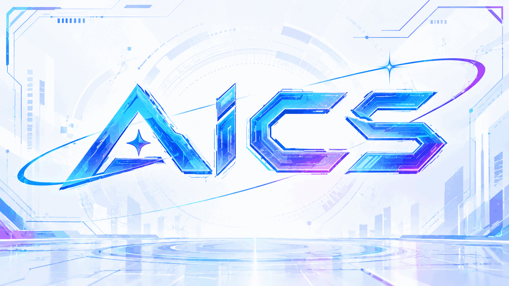

  <picture>
    <source srcset="./docs/images/title.png" media="(prefers-color-scheme: dark)">
    
  </picture>

<h1 align="center">AI-CS Learning Guide</h1>

> _Talk is cheap, show me the code_

    <a href="README.en.md">English</a> | <a href="README.md">简体中文</a>

  
  
  
  

Computer science has long been one of the most popular majors in China. Since the rise of the internet in the 1990s, computing has spread into ever more industries and fields, companies have needed more and more programmers, and that in turn has kept the major in demand. Meanwhile, from GPT-1 in 2018 to GPT-6 in 2026, with its trillions of parameters, the industry programmers work in has changed beyond recognition during the wildest years of AI development. The most fiercely debated question is naturally employment versus unemployment: whether AI will replace programmers is a topic everyone discusses and everyone fears.

At the same time, although many people treat AI as a competitor, plenty of experts and scholars in the field take a positive view. The most famous is Andrew Ng's remark: **"People who use AI will replace people who don't."** In my view, whether AI affects a person's future employment and development depends on their own attitude toward AI and on how well they understand and master it. Humanity has been through three technological revolutions, and none of them stripped people of their value; each gave rise to new professions. As the saying goes, adapt to your environment instead of expecting the environment to adapt to you. Some people will certainly be left behind in the AI era, and most of them share one trait: they stand still, refuse to adapt, and decline to embrace the change AI brings — newer and stronger tools.

My undergraduate major was computer science. When I first entered university, large language models had only recently appeared, and I could not yet feel accurately what AI would change in my industry. Only as I gradually noticed how fast AI was developing — from assisting with code and suggesting approaches to completing an entire project autonomously — did I begin to grasp the direction of its advance.

I believe the question most people want answered today is: what exactly should we learn? Is it still necessary to study data structures? Is it still necessary to write code by hand?

I cannot give a blanket answer to that. But I do believe that however powerful AI becomes, it remains a tool for us, and the most important difference between people and tools is that **people think, and decisions are made by people**. To take part in decisions, we need some understanding of our own field, so that we can use AI to accomplish things better. I believe you will come to understand this idea more deeply as you work through this book.

What sets this book apart from many tutorials is the "AI" element; beyond that, it is a self-study guide. Its readers include students, people already working, and hobbyists. The book is aimed mainly at beginners with little experience, though even those who have worked in computing for years may find something here they did not know — after all, everyone's knowledge differs.

My goal is to let a beginner who has just encountered computing rely entirely on the high-quality resources of the open source community, avoid detours, and grow within two or three years into a well-rounded programmer with solid mathematics and coding ability, having been through dozens of thousand-line projects, command of at least the mainstream languages such as C/C++/Java/JS/Python/Go/Rust, and some exposure to algorithms, circuits, architecture, networks, operating systems, compilers, artificial intelligence, machine learning, computer vision, natural language processing, reinforcement learning, cryptography, information theory, game theory, numerical analysis, statistics, distributed systems, databases, graphics, web development, cloud services, supercomputing, and more. Most importantly, such a programmer understands how AI is developing and knows how to use it in their own field, so that AI becomes a tool that raises their efficiency and ability rather than a competitor that adds burden. Whether you then choose research or employment, I believe you will be highly competitive.

You can [read this book online for free](https://george-102.github.io/AICS_Learning_Guide/en/). For the Chinese version, see [here](https://george-102.github.io/AICS_Learning_Guide/) or the Chinese README at [README.md](./README.md).

## How to Contribute

If you have anything to add to any chapter of the book, you are welcome to open a [Pull Request](https://docs.github.com/en/pull-requests/collaborating-with-pull-requests/proposing-changes-to-your-work-with-pull-requests/creating-a-pull-request-from-a-fork). To contribute a new course, you can use the [template](./template.en.md) file in this repository as a model (use [template.md](./template.md) for the Chinese version) and add its navigation entry in [mkdocs.yml](./mkdocs.yml).

If a course page needs an English version, please provide both the Chinese and English content in your PR.

Since my own ability is limited, the book will inevitably contain typos and even conceptual errors. Please do not hesitate to point them out in an issue.

## On Building a Community

This book supports comments on its pages. If you want to study a particular course with others, you can set up a group chat (QQ or WeChat both work) and then leave a comment under the corresponding course page, stating your learning goal and how to join. Besides, quite a few readers have already set up similar groups in issues, which you can join directly.

## Star History

## ✨ Acknowledgements

Thanks to everyone who has contributed to this project.

## License

The parts written by the project's contributors are licensed under the [MIT LICENSE](LICENSE).

All other parts (including but not limited to the course resources, open source books, and video content mentioned in the book) follow the licenses set by their original authors.